# SolarSpin Technologies: The Centre of the Universe

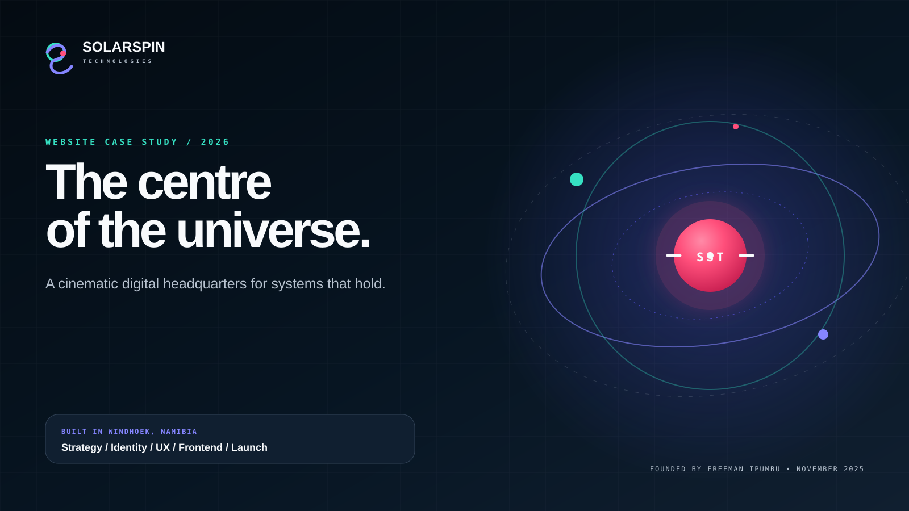

<p align="center">
  <strong>A cinematic digital headquarters for a Namibia-born technology company.</strong><br>
  Product systems, operational depth, founder identity and public proof brought into one living experience.
</p>

<p align="center">
  <a href="https://www.solarspin-namibia.xyz/"><strong>Enter the live experience</strong></a>
  &nbsp;·&nbsp;
  <a href="https://freeman-ipumbu.pages.dev/">Meet the founder</a>
  &nbsp;·&nbsp;
  <a href="https://github.com/SolarSpin-Technologies">SolarSpin on GitHub</a>
</p>

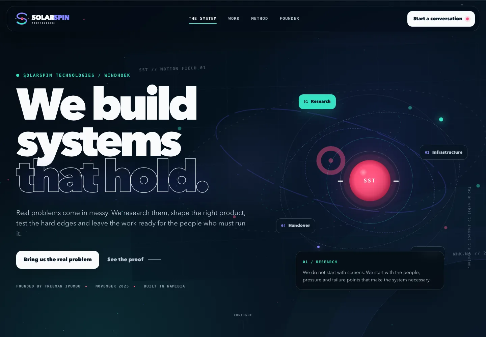

## The assignment

SolarSpin Technologies needed more than a company website.

It needed a centre of gravity for Freeman Ipumbu's work: the operating systems, product research, digital ventures, public case studies and technical judgement that now sit under one company. It also had to feel personal without becoming a founder vanity page, futuristic without becoming cold, and visually alive without asking visitors to fight the interface.

The result is a responsive, dependency-free digital experience built around one idea:

> **We build systems that hold.**

## At a glance

| Signal | Delivered |
| --- | --- |
| Company | SolarSpin Technologies |
| Founder | [Freeman Paul Ipumbu](https://freeman-ipumbu.pages.dev/) |
| Origin | Windhoek, Namibia |
| Launch | October 2026 |
| Public work | A 31-system Public Atlas across four carefully bounded orbits |
| Experience model | Branded ignition, Solar Day and Interstellar atmospheres, interactive system map, Public Atlas, secure Gravity Table and cosmic-address finale |
| Runtime | Static public experience plus focused Cloudflare Pages Functions for intake and health; no frontend framework dependency |
| QA coverage | Eight responsive profiles from 1440 desktop to 320 mobile, including two tablets and 844 × 390 landscape |
| Live site | [www.solarspin-namibia.xyz](https://www.solarspin-namibia.xyz/) |

## The central idea

The interface treats SolarSpin as a small universe with a clear centre. Research, infrastructure, product design and handover move in connected orbits. The visual metaphor is not pasted on top of the content. It explains how the practice works.

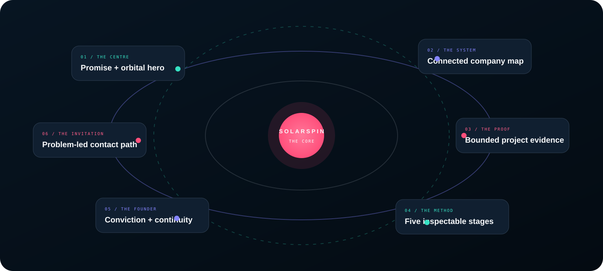

A short branded ignition opens eight chapters:

1. **The centre:** a live orbital hero introduces the company promise.
2. **The system:** a relationship map explains how founder, company, ventures, client work, research and internal systems connect.
3. **The capabilities:** four disciplines turn the promise into a practical offer.
4. **The proof:** the 31-system Public Atlas makes the work inspectable, including its real release boundaries.
5. **The method:** a five-stage rail shows how SolarSpin moves from field evidence to a system that can be handed over.
6. **The founder:** Freeman's reason for building the company becomes part of the product story.
7. **The invitation:** visitors identify what they are carrying, then turn it into a six-stage Gravity Table manifest.
8. **The cosmic address:** the journey resolves from the Milky Way to Windhoek, then signs off with one final branded beat.

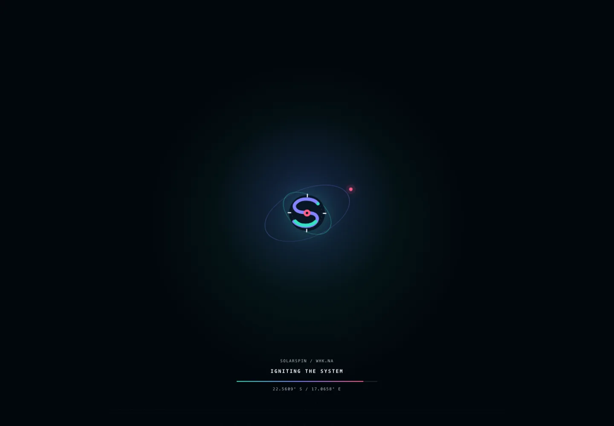

## A visual language with purpose

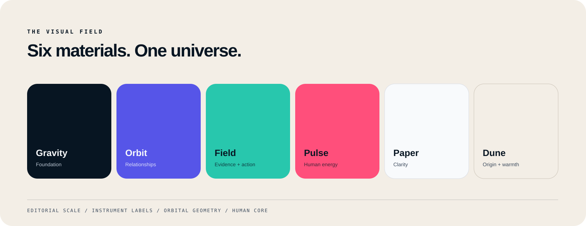

The brand system combines:

- **Gravity:** deep navy space that gives the work authority and room to breathe
- **Orbit:** violet for motion, relationships and technical exploration
- **Field:** mint for active states, evidence and forward movement
- **Pulse:** pink for urgency, human energy and the living core
- **Paper and dune:** warm, high-contrast surfaces used when the founder story becomes more personal

Large editorial type carries the conviction. Monospaced labels add the precision of instrumentation. Fine orbital lines, small signals and restrained glows create depth without turning the interface into decorative science fiction.

The full token logic is documented in [the visual system notes](docs/visual-system.md).

## Solar Day and Interstellar Night

The experience now has two complete celestial atmospheres rather than a light-mode afterthought. **Solar Day** draws from Windhoek light, pale instruments, warm gold and atmospheric blue. **Interstellar Night** keeps the original deep-space gravity, mint signals, violet orbits and pulse-pink energy.

The first atmosphere follows the current Windhoek phase. A visitor can then choose a different orbit for the session. The change is announced to assistive technology, updates the browser theme colour and moves through a restrained visual handoff instead of flashing from one palette to another. The lower journey deliberately returns to space: the founder chapter becomes the horizon between daylight and the cosmic close, so the dark footer feels like transcendence rather than an unfinished theme.

## The cinematic Field Atlas pass

The Field Atlas enhancement makes the chapters feel like parts of one Windhoek-built field instrument while leaving the semantic story intact. The old all-purpose system-lines artwork carried its own opaque paint surface. The visible opaque panels were removed from the cinematic surfaces in favour of transparent, surface-specific linework: a cool night treatment for dark chapters, a dune treatment for the founder chapter and Namib contour lines for the light Project Observatory. Each surface can now keep its own gradient, paper tone and depth without a foreign rectangle sitting behind the content.

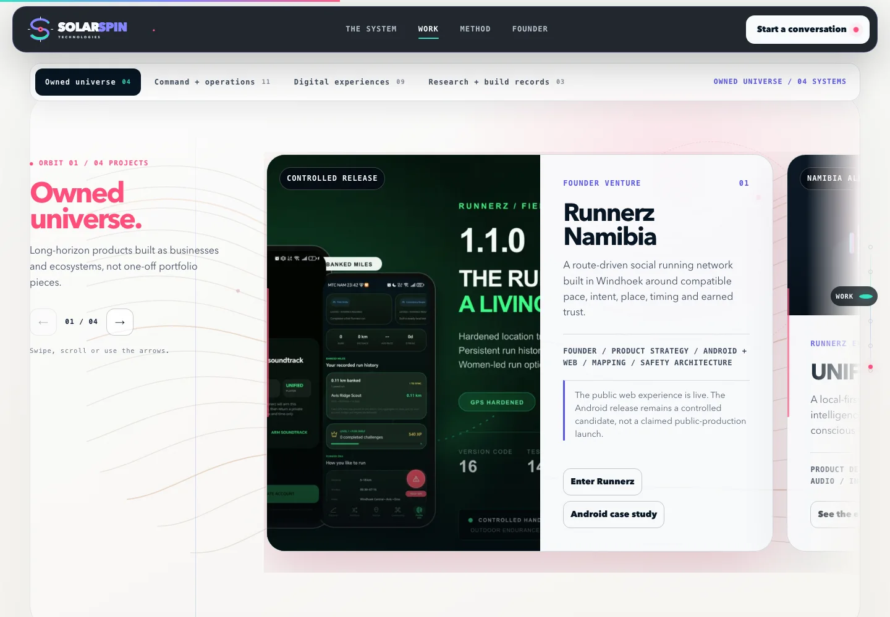

The Field Atlas layer is connected to the interface rather than running as a separate visual show:

- each project orbit carries its own Namib terrain band and accent, moving from pulse pink through field mint and orbit violet to dune amber
- architecture selections move the section's signal origin and colour; method steps move the light and packet; pathway choices retune the field and send one short transmission
- the founder chapter uses its own warm transparent linework instead of reusing a light panel on a light surface
- chapter animation starts only while that section is in view, and project animation is narrowed again to the current orbit
- decorative layers are paint-contained, pointer-inert and removed from forced-colors mode; coarse-pointer layouts also shed selected blur effects
- reduced-motion mode stops the continuous field animations instead of merely slowing them down

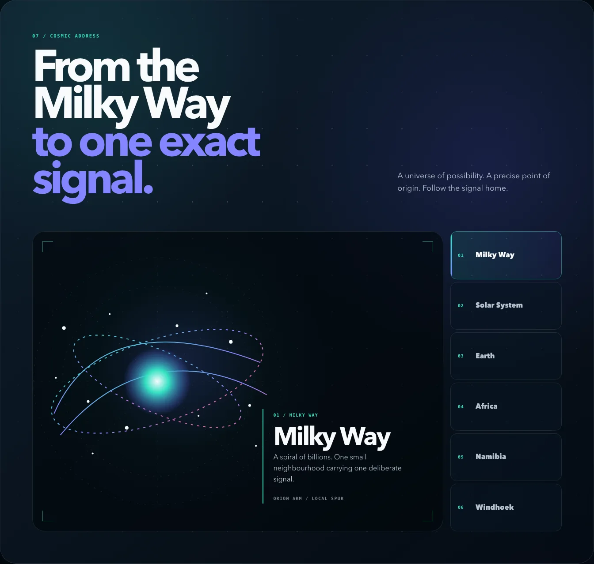

The footer is now a final interactive chapter. Six keyboard-addressable stops trace the public origin story from the Milky Way through the Solar System, Earth, Africa and Namibia to Windhoek. The visual and readout change together, while the route remains understandable as labelled controls and text.

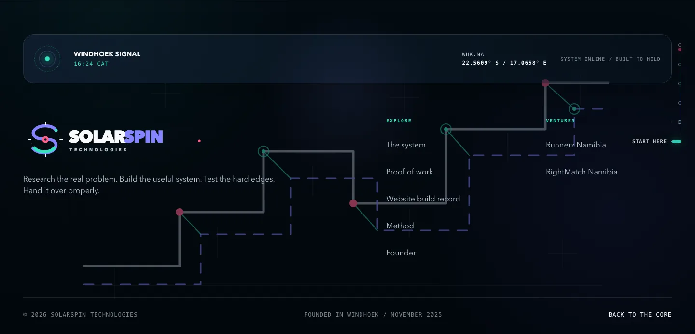

The address resolves into a live Windhoek transmission: current Central Africa Time, the WHK.NA coordinate marker and a restrained system-status signal. The clock is informative but not required for navigation or contact.

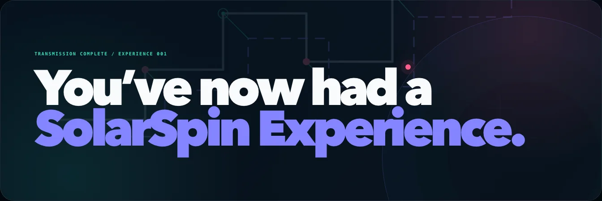

The final panel does not introduce another task. It simply lands the journey with the line: **“You’ve now had a SolarSpin Experience.”**

Verification grew with the visual system. The automated record now covers eight responsive profiles: 1440 and 1280 desktop, 1024 and 768 tablet, touch mobile at 430, 390 and 320 pixels, and an 844 × 390 touch landscape run. Separate checks confirm horizontal rail movement without blocking vertical touch scrolling, zero continuing infinite animations under reduced motion, visible essentials and zero overflow in forced-colors mode, and the full 31-project/four-orbit experience with fallback navigation and email when JavaScript is unavailable.

## The interface behaves like the company

The website does not make visitors read a long manifesto before they understand SolarSpin. Each important idea can be touched, navigated or explored.

### Branded ignition

The experience opens with a 1.48-second, pointer-inert ignition built from the SolarSpin badge, orbit lines, Windhoek coordinates and a clear progress signal. It releases the page automatically and is skipped entirely when reduced motion is requested, forced colours are active or JavaScript is unavailable.

### Orbital hero

The central system responds to four selectable disciplines. The readout changes in place while the background field reacts to pointer movement. Motion is atmospheric, but the information remains available without it.

### Company architecture

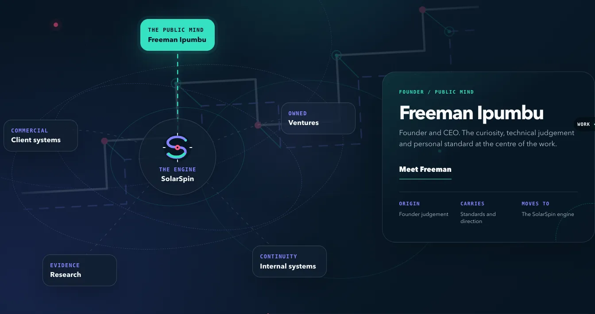

An interactive relationship map shows SolarSpin as the engine between Freeman's public mind, owned ventures, commercial work, research and internal systems. Each node updates a shared readout rather than sending the visitor into another page.

### Public Atlas / proof of work

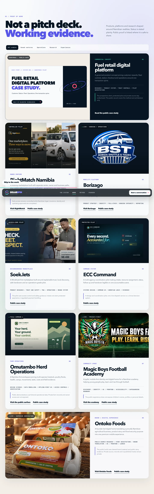

The portfolio is designed as evidence, not a logo wall. Its Project Observatory is a 31-system Public Atlas across Owned Universe, Command and Operations, Digital Experiences, and Research and Build Records. The constellation is an interactive index, not oversized decoration: four visual beacons preview an orbit on hover or keyboard focus, then click, tap or Enter commits the same destination as the sticky navigator. Each chapter uses a horizontally snapping rail with visible progress, arrow controls and native touch or trackpad scrolling. Every card records the role, status, attribution and public boundary of the work.

### Current featured client system: Ontoko Foods

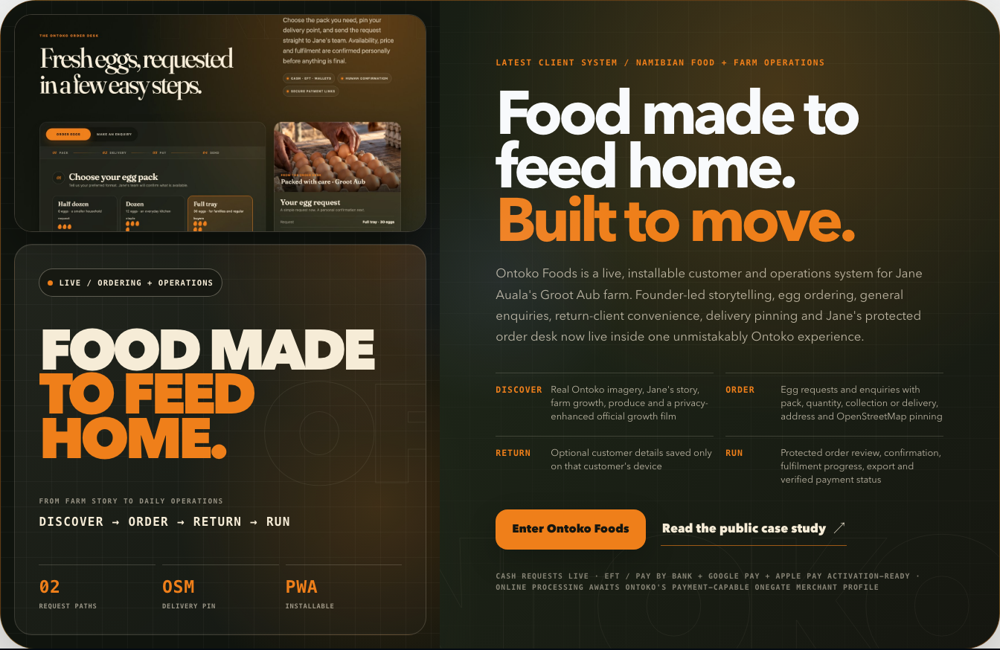

[Ontoko Foods](https://ontoko-foods.pages.dev/) is the current featured client system. The live journey connects Jane Auala's founder story and farm record to an egg-order or general-enquiry path. A customer can choose a pack, provide delivery or collection details, pin a delivery point with OpenStreetMap and optionally keep a device-local return-client profile for a faster future request. Jane's protected admin desk supports order review, export and fulfilment without exposing operational records in this public case study. The separate [public Ontoko case study](https://github.com/freeman-ipumbu/ontoko-foods-case-study) preserves the presentation-safe project record.

The human confirmation boundary is explicit. Every submission remains a request until Jane's team confirms stock, price, delivery or collection and the final total. Cash order requests are live. OneGate-hosted EFT / Pay by Bank, Google Pay and Apple Pay remain activation-gated until Ontoko has its payment-capable merchant profile and settlement configuration. The public record does not describe those online methods as active payment processing.

Foregrounding Ontoko does not change the observatory inventory: the site now presents 31 project stories across four orbits.

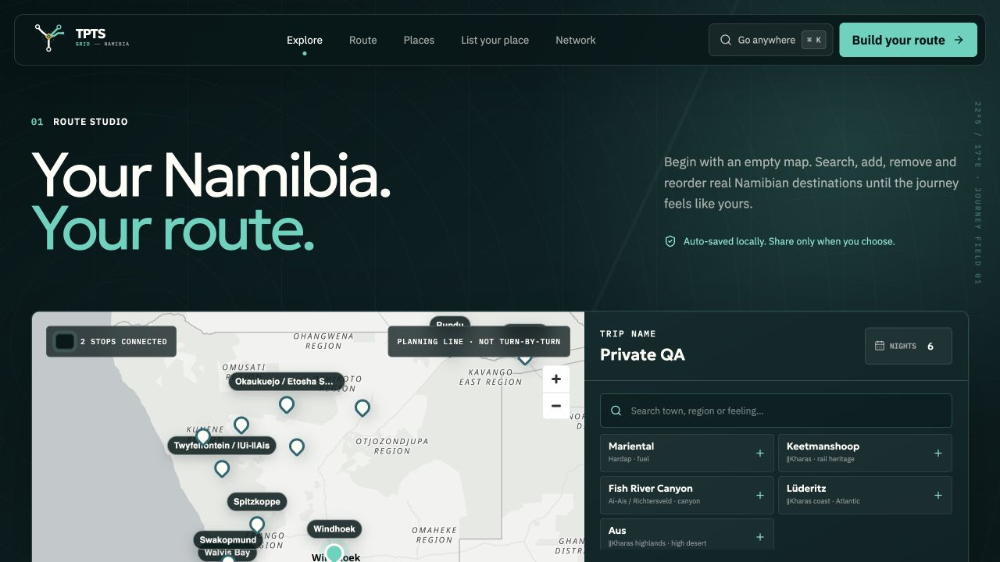

The 30th indexed story is TPTS Grid, the 12th card in Command and Operations. TPTS Financial Technology Group owns the product, while SolarSpin built the digital experience. The public scope is intentionally precise: Namibia-first destination discovery, property-owner claim and onboarding, and a traveller-owned Route Studio. Destination anchors are not presented as live OTA room inventory, and the pilot does not process bookings or payments.


The 31st indexed story is [Career Arc Lab](https://career-arc-lab.onrender.com/), the fourth Research and Build record. The working pilot turns a career ambition into three explainable routes, one recommended 30-day proof sprint and a bounded practitioner-review path. Fit scores are directional, not promises; discovery, demand and transaction gates remain targets to be measured rather than outcomes already achieved. Its separate [public Career Arc Lab case study](https://github.com/freeman-ipumbu/career-arc-lab-case-study) preserves the portfolio-safe product record without publishing source, participant data or unverified pilot evidence.

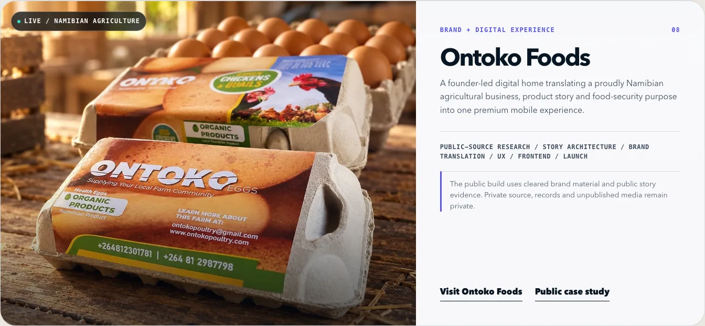

The wider inventory does not blur ownership. Namibia FinePay is explicitly presented as technical leadership through TPTS Namibia. The fuel-retail prospect stays anonymous. Private production repositories remain private, and superseded work is excluded.

### Method explorer

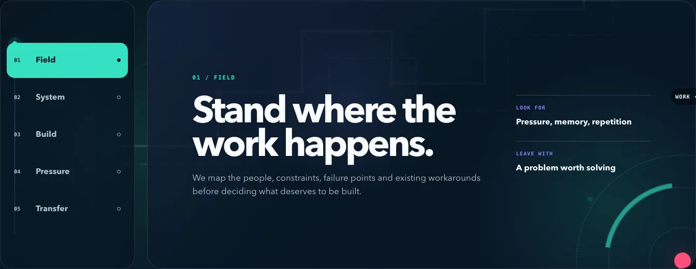

The method rail turns a delivery philosophy into five inspectable decisions: Field, System, Build, Pressure and Transfer. Keyboard controls, clear active states and a live readout keep it useful beyond the animation.

### Gravity Table / secure Start Here intake

Instead of opening with a blank contact form, SolarSpin asks one useful question: **What are you carrying?** Four starting truths tune the experience around an operation, idea, live system or identity. The visitor can also carry up to three project signals out of the Public Atlas as concrete references.

“Put it on the table” opens a six-stage mission dossier: the weight, the people carrying it, the pressure, what already exists, return coordinates and a final manifest the visitor can inspect before transmission. The form is deliberately human in language and conservative in collection.

The live Signal Desk enforces same-site JSON, bounded request size, field validation, a honeypot, Cloudflare Turnstile, privacy-preserving rate limits and an idempotency key. Production stores the record in a dedicated Cloudflare KV archive before Resend attempts an internal notification and a branded receipt. Raw IP addresses and one-time Turnstile tokens are not retained; fingerprints are one-way and peppered; unqualified records have a fixed 120-day review-and-removal boundary. A visible email route remains beside the instrument so an upstream outage cannot make the only contact path disappear.

The public System Pulse reports intake, archive, shield and courier state without revealing secrets or submission data. At the time of this record, the live endpoint reported all four components online from Cloudflare's Windhoek edge.

The founder chapter contains two quieter discoveries. The **Kingsley Star** opens the legacy coordinate behind the company, and the founder's hidden **First Light Build** can route one worthy founder, maker, community project or small organisation into the same protected Gravity Table for consideration. It is a request, not a prize draw or automatic promise; selection, timing, scope and paid third-party costs remain explicit boundaries.

### Cosmic address and closing beat

The cosmic address behaves as a six-stop tab sequence with a shared visual and textual readout. Arrow-key movement, Home and End support, selected-state exposure and full-size touch controls make the interaction inspectable beyond its animation. The finale that follows is static, readable content rather than another gate.

## Motion with an off switch

Motion gives the experience character, but it is never required to reach the content.

- a canvas particle field establishes depth in the hero
- a short badge-and-orbit ignition establishes the brand, then releases the interface
- orbital nodes and satellites make system relationships visible
- reveal sequences establish reading order
- project cards tilt only on capable pointer devices
- project rails expose native swipe, trackpad, arrow-button and keyboard navigation
- the active project orbit follows the visitor without hijacking vertical scrolling
- magnetic controls add tactile feedback to high-value actions
- the header, progress signal and navigation react to position
- the legacy seal opens a focused founder note
- the Kingsley Star and First Light Build reward deliberate exploration without blocking the public journey
- Solar Day and Interstellar Night shift the atmosphere while preserving the same content and control states
- cosmic-address layers transition only when a visitor changes the selected stop
- `prefers-reduced-motion` removes the ignition, canvas and reveal dependency
- essential content remains available when JavaScript is disabled
- animation pauses when the document is not visible
- chapter animation remains paused until its own section is in view
- only the current Project Observatory orbit runs its ambient loops

[Read the interaction and architecture notes](docs/interaction-architecture.md).

## Responsive by composition, not compression

<table>
  <tr>
    <td width="50%">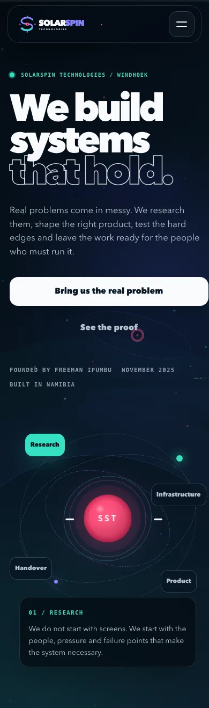</td>
    <td width="50%">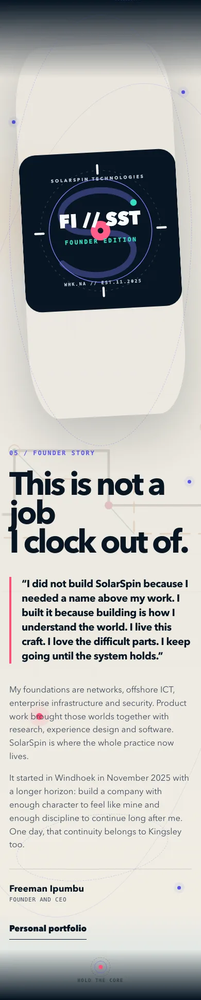</td>
  </tr>
</table>

The mobile experience is recomposed around a vertical rhythm. The hero separates the promise from the orbital control. Navigation becomes an intentional orbit menu. Touch targets expand, supporting copy gets more room, and the founder chapter keeps its editorial impact at 390, 360 and 320 pixels as well as short landscape viewports.

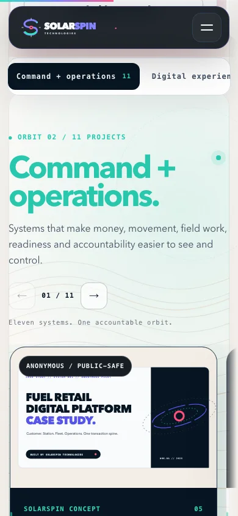

The Project Observatory fix is explicit: selecting an orbit scrolls its active control into view, places the orbit heading below the fixed navigation stack and keeps the heading inside its column at every tested width. The mobile menu still closes on Escape and restores page scrolling.

The result was checked for horizontal overflow across all eight responsive profiles. Every recorded run, including 320-pixel mobile and 844 × 390 landscape, reported zero overflow.

## Accessibility and resilience

The release includes:

- one clear page heading and landmark-based structure
- a keyboard-visible skip link
- high-contrast `:focus-visible` treatment
- semantic buttons for interactive controls
- `aria-pressed`, `aria-selected`, `aria-expanded` and named navigation regions
- live status text for hero orbit, architecture, method and pathway changes, plus visible project-rail position
- a shared textual readout for the selected cosmic-address stop
- Escape-key support for menus and the founder dialog
- keyboard navigation for the method and cosmic-address tab sequences
- reduced-motion handling that skips the ignition and stops continuing loops
- forced-colors handling that removes non-essential scenery and preserves the core chapters
- meaningful image alternatives and hidden decorative imagery
- a JavaScript-free shortcut route and visible essential content
- a custom 404 page and explicit metadata files

This is an implementation and automated QA record, not a claim of independent WCAG certification. The exact checks and their boundaries are documented in [accessibility and QA](docs/accessibility-and-qa.md).

## Technical shape

```text
Cloudflare Pages + custom .xyz domain
        │
        ├── semantic HTML and structured metadata
        ├── one responsive CSS system
        ├── one progressive interaction layer
        ├── SVG and WebP visual assets
        ├── Pages Functions: inquiry intake + public health pulse
        ├── Cloudflare KV: time-bounded signal archive
        ├── Turnstile: human verification
        ├── Resend: internal transmission + visitor receipt
        ├── security and cache headers
        ├── manifest, robots and sitemap
        └── custom 404 experience
```

The public experience ships without a frontend framework or client-side router. Native browser APIs provide the interaction layer, while the small server layer exists only for the Gravity Table and System Pulse:

- `IntersectionObserver` for reveals and navigation state
- `requestAnimationFrame` for the field, pointer response and scroll progress
- `matchMedia` for motion and input capability
- the native `dialog` element for the founder note
- progressive enhancement so the public content does not depend on scripting

That small architecture keeps the company experience portable and easy to hand over. It does not pretend that a small payload alone proves good performance, so no invented Lighthouse score appears in this case study.

## Verification record

| Check | Result |
| --- | --- |
| Local assets | Passed |
| Console and page errors | None in the recorded QA run |
| Missing images | None in the recorded QA run |
| Responsive profiles | Eight passed: 1440, 1280, 1024, 768, 430, 390, 320 and 844 × 390 landscape |
| Horizontal overflow | Zero in all eight responsive profiles, forced-colors mode and no-JavaScript mode |
| Intro release | Hidden, transparent and pointer-inert after the short ignition; skipped for reduced motion and no JavaScript |
| Mobile navigation and orbit headings | Menu open/close passed; active orbit controls remained visible and headings reported zero overflow or fixed-header obstruction |
| Touch and Project Observatory | 31 cards, four synchronized visual beacons and sticky orbit controls, deep links, rail controls, horizontal touch movement and vertical page scrolling passed |
| Interactive readouts | Hero, architecture, method, pathway and six-stop cosmic address passed, including keyboard state changes |
| Celestial themes | Automatic Windhoek phase and manual Solar Day / Interstellar selection passed without changing content availability |
| Gravity Table | Six-stage intake, validation, manifest, email fallback and live four-component System Pulse verified; backend tests cover both KV- and D1-shaped storage paths |
| Performance guardrails | 1,210 DOM nodes, at most nine backdrop filters, 2,400,834 initial transfer bytes and at most ten simultaneous infinite animations in the recorded run |
| Reduced-motion mode | Essential content visible, canvas disabled and zero infinite animations continuing |
| Forced-colors mode | Essential content visible with zero horizontal overflow |
| JavaScript-disabled mode | 31 projects and four orbits visible, with fallback navigation and direct email |
| Custom 404 | Passed |
| Production homepage | Publicly reachable |

## Freeman's role

Freeman Ipumbu led the work end to end:

- company positioning and narrative direction
- SolarSpin visual identity and design language
- information architecture and content hierarchy
- UX and interaction design
- frontend implementation
- project evidence selection and release boundaries
- accessibility and responsive QA
- deployment, metadata and public launch

The website brings together the same range SolarSpin offers its clients: research, systems thinking, experience design, technical execution and a handover that leaves a clear public record.

## What this public case study does not expose

This repository is deliberately separate from the private production repository. It contains narrative, diagrams and approved screenshots. It does not contain:

- production source code
- deployment credentials or Cloudflare configuration
- unpublished brand working files
- private client material
- source repositories belonging to showcased projects
- protected commercial proposals or prospect identities
- private analytics or contact data

[Read the complete publication boundary](docs/publication-boundary.md).

## Repository guide

- [`assets/case-study-cover.svg`](assets/case-study-cover.svg) is the case-study cover.
- [`assets/experience-system.svg`](assets/experience-system.svg) explains the experience architecture.
- [`assets/design-language.svg`](assets/design-language.svg) records the colour and visual roles.
- [`assets/screenshots`](assets/screenshots) contains selected, compressed QA evidence.
- [`assets/screenshots/ignition-intro.webp`](assets/screenshots/ignition-intro.webp) records the short branded opening.
- [`assets/screenshots/field-atlas.webp`](assets/screenshots/field-atlas.webp) records the new orbit terrain treatment.
- [`assets/screenshots/project-orbit-mobile.webp`](assets/screenshots/project-orbit-mobile.webp) records the corrected mobile orbit landing and navigation state.
- [`assets/screenshots/tpts-grid-route-studio-live.jpg`](assets/screenshots/tpts-grid-route-studio-live.jpg) records the TPTS Grid Route Studio public pilot.
- [`assets/screenshots/career-arc-lab.webp`](assets/screenshots/career-arc-lab.webp) records the authentic Career Arc Lab pilot artwork used by the live Public Atlas.
- [`assets/screenshots/cosmic-address.webp`](assets/screenshots/cosmic-address.webp) records the Milky Way-to-Windhoek address sequence.
- [`assets/screenshots/windhoek-transmission.webp`](assets/screenshots/windhoek-transmission.webp) records the live-location footer treatment.
- [`assets/screenshots/experience-finale.webp`](assets/screenshots/experience-finale.webp) records the final branded sign-off.
- [`docs/visual-system.md`](docs/visual-system.md) documents the design system.
- [`docs/interaction-architecture.md`](docs/interaction-architecture.md) explains progressive interaction and technical choices.
- [`docs/accessibility-and-qa.md`](docs/accessibility-and-qa.md) records accessibility and verification scope.
- [`docs/publication-boundary.md`](docs/publication-boundary.md) states what is public and what remains private.
- [`scripts/verify-case-study.sh`](scripts/verify-case-study.sh) checks the public package and its external links.

Run the local verification:

```sh
./scripts/verify-case-study.sh
```

## Built by SolarSpin Technologies

This case study and the experience it documents were designed and delivered by **[SolarSpin Technologies](https://www.solarspin-namibia.xyz/)**, founded by [Freeman Paul Ipumbu](https://freeman-ipumbu.pages.dev/) in Windhoek, Namibia.

The source is private. The thinking is visible. The standard is public.

> **You’ve now had a SolarSpin Experience.**

© 2026 SolarSpin Technologies. See [LICENSE](LICENSE) for the repository terms.
